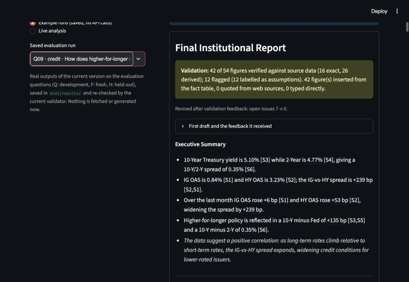
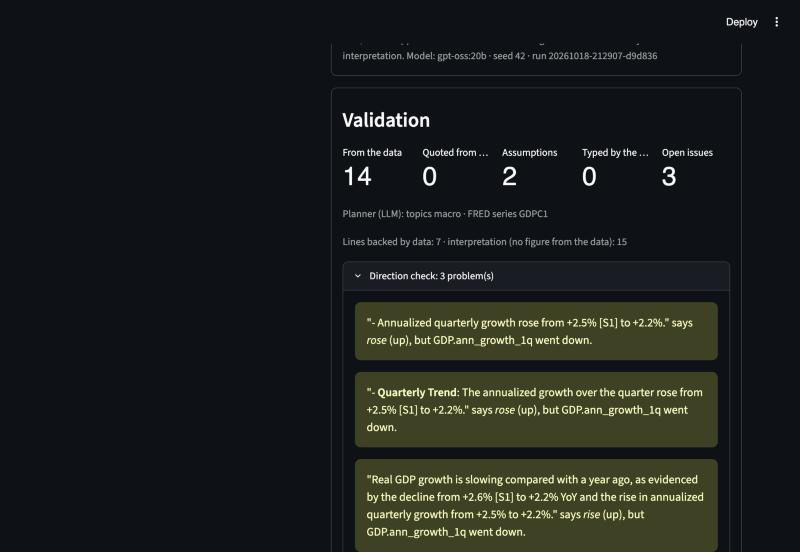

# FinanceAgent-AI-Platform

[](https://github.com/SiuLok6San/FinanceAgent-AI-Platform/actions/workflows/tests.yml)

A multi-agent research assistant that answers investor questions on macro, rates, credit, equities and portfolios with live FRED, Finnhub and Tavily data. The LLM agents never type a number: they refer to fact IDs, code inserts each value with its source, and a deterministic validator checks the wording around the numbers against the data before the report is shown.

**Live demo: [financeagent-ai-platform.streamlit.app](https://financeagent-ai-platform.streamlit.app)**: browse the 40 saved evaluation runs (real outputs, no API calls). Live analysis is off on the public site; run it locally with your own keys (see *How to run*).

## Context

- **Columbia University industry-sponsored course project with [Boosted.ai](https://boosted.ai)**, Oct–Dec 2025, built by a two-person team, Yuechen and Yuqing. We designed and built the system together and presented it together to Boosted.ai stakeholders: the solution and its business use cases, and the final findings and recommendations.
- **Who led which part**
  - **Yuechen** ([@SiuLok6San](https://github.com/SiuLok6San)): the multi-agent pipeline (Planner → Researcher → Analyst → Reasoner → Writer) and the two-tier, rule-based routing across macro, rates, credit, equity and portfolio questions; the integration of a locally hosted Llama 3 model (via Ollama) with live data from FRED, Finnhub and Tavily, and the Streamlit interface, built using AI coding tools; the institutional-style report format with source citations and a review step for weak claims.
  - **Yuqing** ([@yuqingtao1103](https://github.com/yuqingtao1103)): the data layer of the system, connecting document retrieval with the external market-data APIs the agents work from.
- **Reading the git history.** The course code was uploaded in a single commit in Feb 2026 (`0468eea`), so the history does not show who wrote which part of it. The Oct 2026 revision (v2, v3) was made with AI coding tools; its commits are attributed by area of the code, with the data layer under Yuqing's account.
- **Versions** (git tags; nothing in the history was rewritten):
  - `v1.0-course`: the code as submitted in Dec 2025.
  - `v2.0-validation` (Oct 2026): a deterministic validator on the model's free-text reports, plus one feedback round.
  - v3 (this version, Oct 2026): grounded by construction. See the [CHANGELOG](CHANGELOG.md).

## How it works

```
 Question (+ optional ticker)
        │
        ▼
 Planner (LLM) ─────── JSON: topics + FRED series from a fixed catalog; checked in code,
        │              rule-based router as fallback
        ▼
 Researcher (code) ─── FRED (5–10 years of history), Finnhub, Tavily → tables + sources [S1], [S2] …
        │
        ▼
 Fact store (code) ─── every value gets an ID:  HY_OAS.latest    = 3.23% [S2]
        │                                       HY_OAS.chg_1m    = +53 bp [S2]
        │                                       HY_OAS.pctile_3y = 75th percentile [S2]
        ▼
 Analyst → Reasoner → Writer (LLM) ─── write {{HY_OAS.latest}}, {{S5: 25.2%}} or {{assume: 10–15%}},
        │                               never a bare number
        ▼
 Renderer (code) ───── inserts the exact value and its citation
        │
        ▼
 Validator (code) ──── open issues ──► Writer revises once; kept only if open issues go down
        │
        ▼
 Streamlit UI ──────── hover a number to see its fact; lines without data are marked as interpretation
```

**Why placeholders.** In v2 the model typed numbers and the validator guessed which fetched value each one matched, so a coarse number could match by coincidence ("12×" matched a count of 12 hold ratings). In v3 the link from number to data is exact. Any number the model still types stands out and counts as an open issue.

**What the validator checks** ([`validators.py`](validators.py), thresholds in [`config/validation.toml`](config/validation.toml)):

1. **Grounding.** Every number is a fact from the data, a quote (it must appear in the text of the source it names), a labelled assumption, or typed by the model (an open issue). A number labelled "(assumption)" that is written the same way in a source the line cites is that source's figure, so it is an open issue too.
2. **Direction.** "Spreads narrowed" next to a change of +53 bp.
3. **Comparisons.** "Above its five-year average" against the two values, and comparisons between different units (a P/E multiple against an index level).
4. **Wording against history and trend.** "Near five-year lows" against the value's percentile; "widening" against its recent change; "inflation is cooling" against the 12-month rate a month earlier and the recent annualized pace. Scenario, risk and monitoring sections are skipped: they describe what could happen.
5. **Citations, freshness and no-data honesty.** Every citation exists and figures are cited; each series is as recent as its frequency allows; a topic with no data is disclosed.

Each report line is then labelled **data** (it states a checked figure) or **interpretation** (no figure from the data: the model's reading, which the validator cannot check). The UI shows interpretation lines in italics.

**What it cannot check.** Whether the reasoning is right ("rate cuts will compress IG spreads") or whether an investment conclusion follows. The validator makes sure the numbers and the words describing them match the data; the rest is labelled, not verified.

## Results

All three versions answered the same 40 investor questions with `gpt-oss:20b` on the hosted Ollama API (original and v2 on 2026-10-18, v3 on 2026-10-19, UTC), and the same current validator scored every report. The main comparison is the 10 **fresh** questions: frozen before the final runs and never run on any version before. Full tables (held-out and development sets too), per-question results and caveats: [`eval/RESULTS.md`](eval/RESULTS.md); how the runs were made: [`eval/NOTES.md`](eval/NOTES.md).

**Fresh questions (10)**

| | Original (Dec 2025) | v2 | v3 first draft | v3 final |
|---|---|---|---|---|
| Reports with any fetched data | 5/10 | 10/10 | 10/10 | 10/10 |
| Numbers traceable to fetched data | 12/198 (6%) | 130/205 (63%) | 154/212 (73%) | 138/208 (66%) |
| Numbers labelled as the writer's assumption | 0% | 27% | 24% | 34% |
| **Untraceable numbers** (not in the data, not in a fetched source text, not labelled) | 130/198 (66%) | 7/205 (3%) | 7/212 (3%) | 0/208 (0%) |
| Numbers typed by the model instead of inserted | all | all | 28 | 0 |
| "(assumption)" on a number from the source the line cites | 0 | 9 | 0 | 0 |
| Change figures described in the wrong direction | 0 | 2 | 1 | 3 ¹ |
| Paragraphs with figures but no citation / citing the wrong source | 6 / 3 | 12 / 1 | 0 / 0 | 0 / 0 |
| Reports with a no-data honesty issue | 7/10 | 0/10 | 0/10 | 0/10 |

¹ All three are in one report (F01) and were introduced by the feedback loop; see below.

On the held-out and development questions the pattern is the same. Untraceable numbers in final reports: original 81% and 71%, v2 2% and 2%, v3 0% and 0%. Traceable numbers: 7% and 9%, 70% and 65%, 78% and 73%.

**Routing** (exact expected topic set, fresh / held-out / dev): original keyword rules 5/10, 4/10, 12/20; current keyword rules 8/10, 8/10, 17/20; v3 Planner (LLM) 8/10, 4/10, 11/20. The current rules were fixed after seeing the development questions.

What this shows, and what it does not:

- **Most of the gain is from original to v2.** The original agents never saw the data they fetched (only table titles reached the Writer), and no credit data was fetched for "high-yield" or "IG vs HY" questions.
- **v3's gain over v2 is bookkeeping, not judgment.** In the final v3 reports on fresh questions every number is inserted from the data, quoted from a source or labelled as an assumption (held-out and development finals still have 6 and 37 typed numbers, each an open issue), and no citation is missing or wrong. v2 still had 2–3% untraceable numbers and 12–42 citation problems per question set.
- **A third of v3's numbers on fresh questions are labelled assumptions** (34%, v2 27%). The feedback loop turned typed numbers into labels: on fresh questions, 28 typed numbers went to 0 and assumptions from 50 to 70. A label discloses a number; it does not verify it. The only check on labels is that they do not hide a number from the source the line cites. "Traceable" falls from first draft to final (73% → 66%) because the draft count includes typed numbers that only matched a fetched value; in the final, every traceable number is an inserted fact.
- **The wording checks are the weak part.** In the final run the Writer received 30 direction, comparison and wording findings. Read against the data, 9 were real, 13 were false alarms and 8 were unclear ([`eval/FEEDBACK_REVIEW.md`](eval/FEEDBACK_REVIEW.md)). The revision fixed 6 of the real ones. After false alarms it also made four correct statements wrong: "annualized growth fell from +2.5% to +2.2%" became "rose". The causes were removed after the run, and the current validator flags those errors (the "3" above). Those fixes were made after reading these reports, so they are not independently tested.
- **The LLM Planner routes no better than the keyword rules** it falls back on.

Example reports (real runs, unedited model output, with the first draft, the feedback and every figure's source): [macro](examples/Q01-macro.md) · [credit](examples/Q09-credit.md) · [equity](examples/Q13-equity.md).

## Screenshots

The credit question Q09 in the app, from a saved run. Numbers from the data have a dotted underline (hover shows the fact ID and its source); grey marks the writer's assumptions; lines with no figure from the data are in italics. The third bullet shows what the validator misses: "+239 bp" is the level of the HY–IG spread, not how much it widened (+47 bp over the month).



The validation panel for a fresh question (F01). The three flagged sentences were right in the first draft ("fell from +2.5% to +2.2%"); a false alarm in the feedback loop made the Writer change them, and the current validator flags the result.



## How to run

Requires Python 3.11+ (tested on 3.12).

```bash
git clone https://github.com/SiuLok6San/FinanceAgent-AI-Platform.git
cd FinanceAgent-AI-Platform
python3 -m venv .venv
source .venv/bin/activate
pip install -r requirements.txt
cp .env.example .env
```

Fill in `.env` (it is gitignored). Free keys: [FRED](https://fredaccount.stlouisfed.org/apikeys), [Finnhub](https://finnhub.io/register), [Tavily](https://app.tavily.com). Then choose how to run the LLM:

- **Local Ollama**: install [Ollama](https://ollama.com), pull a model and point `.env` at it (`LLM_API_BASE=http://localhost:11434`, `LLM_MODEL_NAME=llama3`, `OLLAMA_API_KEY` empty):

  ```bash
  ollama pull llama3
  ```

- **Hosted Ollama API**: create a key at [ollama.com/settings/keys](https://ollama.com/settings/keys) and set `LLM_API_BASE=https://ollama.com`, `OLLAMA_API_KEY=...` and a hosted model such as `LLM_MODEL_NAME=gpt-oss:20b`. The free tier serves one request at a time.

Start the app:

```bash
streamlit run app.py
```

The app opens on **Example runs** (saved evaluation outputs, no API calls); switch to **Live analysis** to run the pipeline. To deploy it (e.g. Streamlit Community Cloud), put the same keys in the app's secrets and also set `APP_PASSWORD`: live runs then need that password, so visitors cannot spend your API quota. Without an LLM endpoint configured, a deployment shows only the example runs.

Run the tests (no API keys or LLM needed; everything external is mocked):

```bash
pip install -r requirements-dev.txt
pytest
```

Reproduce the evaluation (needs all keys, uses API quota, and takes hours on the hosted free tier; run one at a time):

```bash
python eval/run_eval.py --pipeline v3 --set all
```

```bash
python eval/run_eval.py --pipeline v2 --set all
```

```bash
python eval/run_eval.py --pipeline original --set all
```

```bash
python eval/score.py
```

## Limitations

- **Reasoning is not checked.** The validator checks numbers and the words that describe them (direction, comparisons, position in history, trend). Causal claims, scenario logic and investment conclusions are labelled as interpretation, not verified. An LLM critic could flag doubtful reasoning, but measuring whether its flags are right needs examples labelled by someone with finance expertise; it has not been built.
- **The feedback loop can make a report worse.** The checks it relies on have false alarms (13 of 30 findings in the final run), and the Writer follows them: four correct statements became wrong. A revision is kept when the validator counts fewer open issues, so a revision that fixes several real issues while introducing a new one, or that follows a false alarm, is still kept.
- **The model can misread what a fact means.** The numbers are inserted correctly but described wrongly: "+3.4% recorded a year earlier" for the 12-month rate a month earlier (Q01), "+1.2% in the prior quarter" for the change over two quarters (Q03), and "widening the spread by +239 bp" for the spread's level (Q09; spreads between two series are displayed with a sign, which invites this). No check reads the meaning of a fact.
- **The wording checks are phrase lists.** Direction, comparison, history and trend checks match configured phrases ([`config/validation.toml`](config/validation.toml)). A contradiction phrased differently passes, and a phrase used in an unusual sense can be flagged. They were tuned on the development reports, and after the final run on all 40 v3 reports.
- **Assumption labels are a policy choice.** A number labelled as the writer's assumption is not checked, except that it must not be a number from a source the line cites. One final report calls 0.00% "the threshold that signals a recession" for the Sahm rule (it is 0.50 points); as an assumption, it passes.
- **Keyword fallback routing.** When the Planner's output is unusable, the rule-based router decides, and it misclassifies unusual phrasings.
- **Not reproducible run to run.** The seed is sent, but in our test the hosted Ollama API returned different outputs for the same prompt and seed; the saved outputs in `eval/results/` are the record.
- **Small evaluation.** 10 fresh, 10 held-out and 20 development questions written by the authors, one model (`gpt-oss:20b`), and live data that change every day. Two held-out questions were once used in a smoke test ([`eval/NOTES.md`](eval/NOTES.md)).
- **Free API limits.** The hosted Ollama free tier serves one request at a time; Finnhub allows 60 calls/min; Tavily has monthly credits.
- **Not investment advice.** This is a course project for research and education.

## Project structure

```
FinanceAgent-AI-Platform/
├── app.py                 # Streamlit UI: report with hover-to-source numbers, validation panel, tables, charts
├── demo.py                # Saved evaluation runs for the example mode (no API calls)
├── agents.py              # Pipeline: Planner → Researcher → Analyst → Reasoner → Writer → Validator (+ revision)
├── answer_builder.py      # Writer and revision prompts, source ids, citation parsing
├── fact_store.py          # Fetched tables → fact IDs (levels, changes, percentiles, spreads, company metrics)
├── render.py              # {{ID}} / {{S#: …}} / {{assume: …}} placeholders → values and citations
├── validators.py          # Deterministic checks and the feedback for the Writer
├── facts.py               # Value matching for free-text reports (used to score original and v2)
├── router.py              # Tier-1 rule-based routing (Planner fallback)
├── router_tier2.py        # Tier-2 rule-based specialization
├── data_providers.py      # FRED / Finnhub / Tavily bundles with source metadata and status
├── tools.py               # Low-level HTTP clients for the three APIs
├── llm.py                 # Ollama /api/chat client (local or hosted): time limit, retries, 429 handling
├── settings.py            # Loads .env and config/*.toml
├── config/                # Routing rules, data sources, validation thresholds, LLM settings
├── eval/                  # Question sets, run / score scripts, RESULTS.md, NOTES.md, saved outputs
├── examples/              # Real v3 reports + screenshots
├── tests/                 # pytest suite
├── docs/                  # Revision spec
├── requirements.txt       # Runtime dependencies (pinned)
├── requirements-dev.txt   # + pytest
└── .env.example           # API keys and LLM settings template
```
