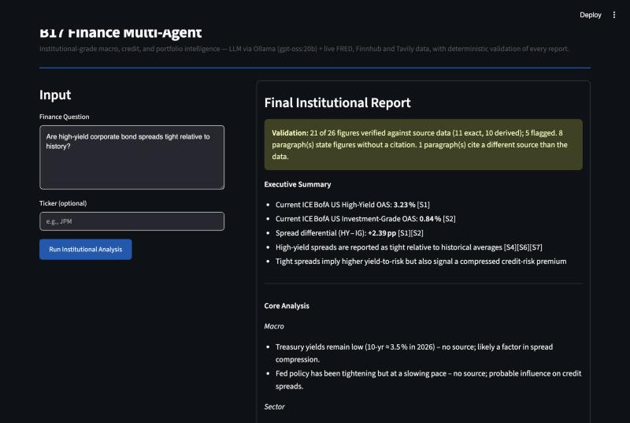
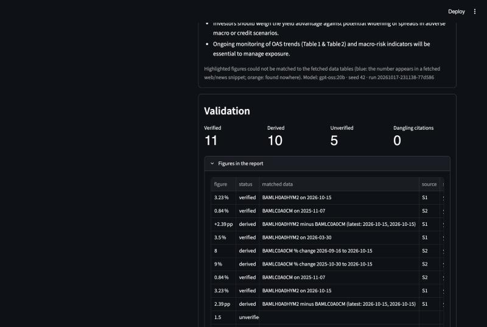
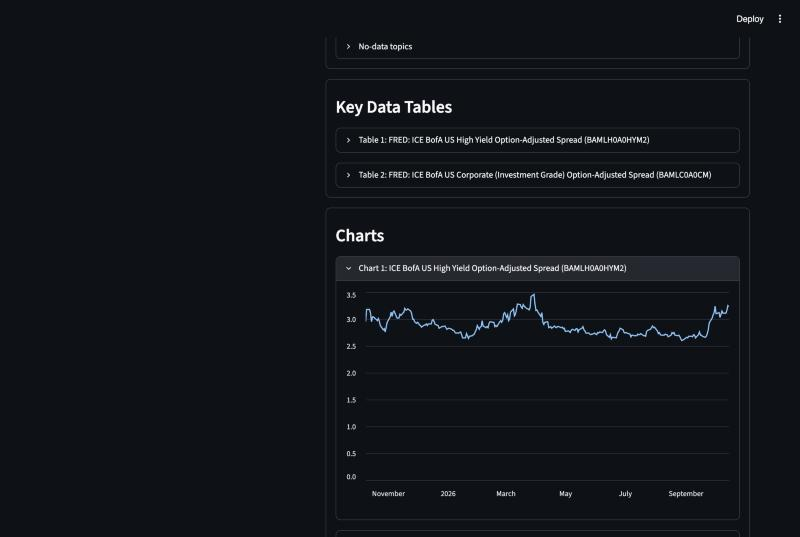

# FinanceAgent-AI-Platform

A multi-agent research assistant that answers investor questions with live FRED, Finnhub and Tavily data — and checks every number and citation in its own reports with a deterministic validation layer.

## Context

- **Columbia University industry-sponsored course project with [Boosted.ai](https://boosted.ai)**, Oct–Dec 2025. Team project.
- **Roles in this repository**
  - **Yuechen** ([@SiuLok6San](https://github.com/SiuLok6San)): designed the multi-agent pipeline (Planner → Researcher → Analyst → Reasoner → Writer) and the two-tier, rule-based routing across macro, rates, credit, equity and portfolio questions; integrated a locally hosted Llama 3 model (via Ollama) with live data from FRED, Finnhub and Tavily, and built the Streamlit interface using AI coding tools; defined the institutional-style report format with source citations and a review step for weak claims; presented the solution and its business use cases to Boosted.ai stakeholders.
  - **Yuqing** ([@yuqingtao1103](https://github.com/yuqingtao1103)): built the data layer that connects the analysis to external market-data APIs; presented the final findings and recommendations to Boosted.ai stakeholders.
- **Revised in Oct 2026** to add a deterministic validation layer, an evaluation set with before/after results, real example reports, dependency cleanup and better error handling. See the [CHANGELOG](CHANGELOG.md).

## How it works

```
 Question (+ optional ticker)
        │
        ▼
 Router (rule-based) ──► topic tags: macro / rates / credit / equity / portfolio (+ tier-2 detail)
        │
        ▼
 Planner ──► Researcher ──► Analyst ──► Reasoner ──► Writer ──► Validator ──► Streamlit UI
  (LLM)      (no LLM:         (LLM)       (LLM)        (LLM)      (no LLM)
             FRED, Finnhub,
             Tavily)
```

- **Routing is rule-based, not learned.** `router.py` and `router_tier2.py` match whole-word keywords from [`config/routing.toml`](config/routing.toml) (hyphens and plurals handled, with a few exclude phrases such as "unemployment rate" for the rates tag). It is fast, transparent and testable, and it misclassifies unusual phrasings (see Results).
- **Researcher (no LLM).** Picks FRED series from keywords in the question ([`config/data_sources.toml`](config/data_sources.toml): policy rate, Treasury yields and curve, mortgage rate, HY and IG credit spreads, CPI, PCE, unemployment, Sahm rule, real GDP, S&P 500, VIX, WTI), pulls Finnhub quote / profile / key metrics / analyst trends / news when a ticker is given, and runs a Tavily web search. Every source gets an id `[S1]`, `[S2]`, …, and missing API keys or failed calls are recorded instead of crashing.
- **Analyst → Reasoner → Writer (LLM).** Each agent gets a *KEY DATA* block with the fetched values, recent changes and their source ids, plus the list of routed topics with no data. The Reasoner removes claims not supported by that data; the Writer produces the report (executive summary, analysis, scenarios, risks, implications) with `[S#]` citations.
- **Validator (no LLM).** [`validators.py`](validators.py) checks the final text:
  1. **Numeric grounding** — every number (%, bp, $, multiples, dates used as values) is *verified* (matches a fetched value within the rounding its digits imply, with unit conversion such as 0.0425 = 4.25% or 25 bp = 0.25 pp), *derived* (a change, % change, annualized growth or spread computed from fetched values) or *unverified*.
  2. **Citation integrity** — `[S#]` markers must point to a fetched source; paragraphs with grounded figures must cite something; a citation should point to the source the figure came from.
  3. **Data freshness** — the latest observation of each series against what its frequency allows (e.g. a monthly series more than 60 days old).
  4. **No-data honesty** — routed topics with no fetched data must be disclosed and must not carry unverified figures.

  Flagged content is never deleted: the report gets a one-line summary on top — for the credit example below, *"31 of 45 figures verified against source data (17 exact, 14 derived); 14 flagged …"* — and the UI highlights flagged figures in a Validation panel.

## Results

Both pipelines were run on 20 investor questions (4 each on macro, rates, credit, equity and portfolio) on 2026-10-18 with `gpt-oss:20b` through the hosted Ollama API, and the same validator scored both. "Original" is the Dec 2025 code, run unchanged from its git commit except for the LLM connection. Full tables, per-question results and caveats: [`eval/RESULTS.md`](eval/RESULTS.md).

| | Original (Dec 2025) | Revised (Oct 2026) |
|---|---|---|
| Routing: exact match of expected topic tags (rule-based, no LLM) | 12/20 | 17/20 ¹ |
| Reports with any fetched data table | 9/20 | 20/20 |
| Numbers in reports traceable to fetched data (exact or derived) | 46/527 (9%) | 303/517 (59%) |
| Reports with a no-data honesty issue | 13/20 | 2/20 |
| Dangling citations | 0 | 0 |
| Paragraphs stating grounded figures without a citation | 19 | 65 |

¹ The router fixes were written after the questions were drafted, so this is optimistic.

What this shows, and what it does not:

- Run on the original outputs, the validator found only 9% of numbers traceable to fetched data. The causes were in the code: the original agents never saw the data they fetched (only table titles reached the Writer), and no credit data was fetched for "high-yield" or "IG vs HY" questions. The revised pipeline fixes both, and traceable numbers rose to 59% (the evaluation does not separate the effect of each change).
- 41% of the revised reports' numbers still cannot be traced to fetched data, and the revised reports leave many grounded figures uncited (65 paragraphs).
- "Traceable" is a lower bar than "correct": a coarse number can match by coincidence. In the JPM example, "P/E could fall below 12×" matched the count of 12 *hold* ratings; 111 of the 303 traceable numbers are written without decimals.

Example reports (real runs, unedited model output, with every figure's check): [macro](examples/Q01-macro.md) · [credit](examples/Q09-credit.md) · [equity](examples/Q13-equity.md).

## Screenshots

A credit question ("Are high-yield corporate bond spreads tight relative to history?") run in the app on 2026-10-18 with live data:







In the second screenshot, "3.5%" (the report's 10-year Treasury yield) matched an earlier value of the high-yield spread: no Treasury data was fetched for this question, so this is a coincidental match of the kind described under Limitations.

## How to run

Requires Python 3.11+ (tested on 3.12).

```bash
git clone https://github.com/SiuLok6San/FinanceAgent-AI-Platform.git
cd FinanceAgent-AI-Platform
python3 -m venv .venv
source .venv/bin/activate
pip install -r requirements.txt
cp .env.example .env
```

Fill in `.env` (it is gitignored). Free keys: [FRED](https://fredaccount.stlouisfed.org/apikeys), [Finnhub](https://finnhub.io/register), [Tavily](https://app.tavily.com). Then choose how to run the LLM:

- **Local Ollama** — install [Ollama](https://ollama.com), then pull the model and point `.env` at it (`LLM_API_BASE=http://localhost:11434`, `LLM_MODEL_NAME=llama3`, `OLLAMA_API_KEY` empty):

  ```bash
  ollama pull llama3
  ```

- **Hosted Ollama API** — create a key at [ollama.com/settings/keys](https://ollama.com/settings/keys) and set `LLM_API_BASE=https://ollama.com`, `OLLAMA_API_KEY=...` and a hosted model such as `LLM_MODEL_NAME=gpt-oss:20b`.

Start the app:

```bash
streamlit run app.py
```

Run the tests (no API keys or LLM needed; everything external is mocked):

```bash
pip install -r requirements-dev.txt
pytest
```

Reproduce the evaluation (needs all keys; takes a while and uses API quota):

```bash
python eval/run_eval.py --pipeline original
python eval/run_eval.py --pipeline revised
python eval/score.py
```

## Limitations

- **The LLM can still misread data.** The validator checks that a number exists in the fetched data, not that the reasoning around it is right. A coarse number ("4%", "12×") can match an unrelated value by coincidence; the Validation panel shows which series each figure matched and whether it is on the sentence's topic.
- **Keyword routing can misclassify unusual questions**, e.g. "stocks and bonds fall together" is tagged rates and equity as well as portfolio.
- **Free API limits.** Finnhub (60 calls/min), Tavily (monthly credits) and the hosted Ollama API all have free-tier limits; FRED requires a free key.
- **Not reproducible run to run on the hosted API.** The seed is sent, but in our test the hosted Ollama API returned different outputs for the same prompt and seed, so saved outputs in `eval/results/` are the record.
- **Small evaluation.** 20 questions written by the authors; they also served as the development set for the router fixes.
- **Not investment advice.** This is a course project for research and education.

## Project structure

```
FinanceAgent-AI-Platform/
├── app.py                 # Streamlit UI (report, Validation panel, tables, charts, sources)
├── agents.py              # Pipeline: Planner → Researcher → Analyst → Reasoner → Writer → Validator
├── answer_builder.py      # Writer prompt, source ids, citation parsing
├── validators.py          # Deterministic validation layer
├── facts.py               # Fetched tables → numeric facts and the KEY DATA prompt block
├── router.py              # Tier-1 rule-based routing
├── router_tier2.py        # Tier-2 rule-based specialization
├── data_providers.py      # FRED / Finnhub / Tavily bundles with source metadata and status
├── tools.py               # Low-level HTTP clients for the three APIs
├── llm.py                 # Ollama /api/chat client (local or hosted)
├── settings.py            # Loads .env and config/*.toml
├── config/                # Routing rules, data sources, validation thresholds, LLM settings
├── eval/                  # Questions, run/score scripts, RESULTS.md, saved outputs
├── examples/              # Real reports from the revised pipeline + screenshots
├── tests/                 # pytest suite
├── docs/                  # Revision spec
├── requirements.txt       # Runtime dependencies (pinned)
├── requirements-dev.txt   # + pytest
└── .env.example           # API keys and LLM settings template
```
